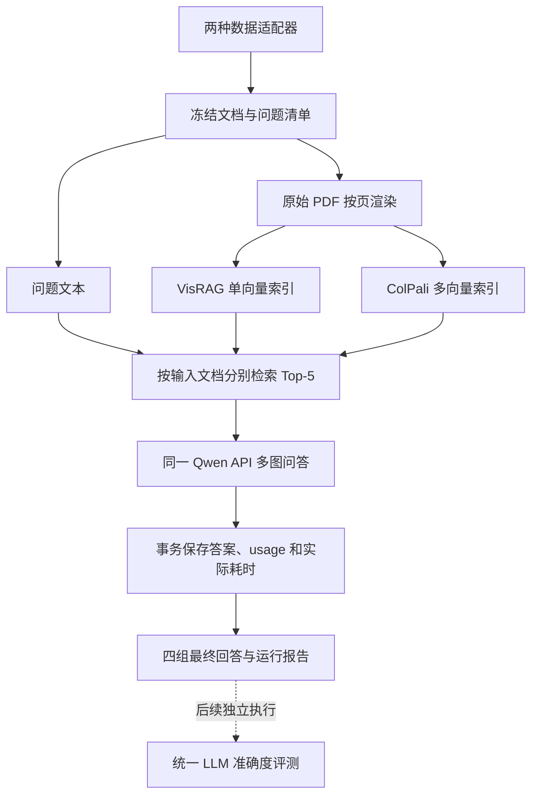

# VisRAG 与 ColPali 双基线实施计划

更新日期：2026-10-23。

状态：设计阶段；本文中的模块、配置、命令和产物均为拟实现接口。
本轮只更新文档，不启动模型编码、生成 API 或评判 API 调用。

原计划来源：
`C:/Users/wuzan/.gemini/antigravity-ide/brain/626847b2-d2c7-479a-b97b-d0a46e5fd354/visrag_baseline_plan.md`。

## 已确定的范围

目标是完成两个视觉文档 RAG 基线在两个数据集上的回答生成与结果留存，
后续再交给统一的 LLM 评测流程比较准确度。当前不实现或调用评判器。
两个检索器共用页面素材、生成接口和结果格式。

| 数据集 | 检索器 | 生成器 | 检索页数 | 当前交付 |
| --- | --- | --- | --- | --- |
| NationStandardBench | VisRAG-Ret | 用户现有 Qwen API | 5 | 最终回答与运行记录 |
| NationStandardBench | ColPali v1.3 HF | 同一 Qwen API | 5 | 最终回答与运行记录 |
| DocBench | VisRAG-Ret | 同一 Qwen API | 5 | 最终回答与运行记录 |
| DocBench | ColPali v1.3 HF | 同一 Qwen API | 5 | 最终回答与运行记录 |

- `top_k` 可配置，默认和主实验均为 `5`。
- 当前不计算任何质量指标。后续统一 LLM 评测只考察答案准确度。
- 记录 API 实际返回的 token 用量、请求时间、阶段耗时、重试和失败情况。
  这些属于资源与执行记录，不增加新的质量评价目标。
- 四组实验分别输出结果，再汇总完成情况、API 实际用量和耗时。
- 本轮不增加 ColQwen2、Oracle、No-RAG、微调或 ReAct 消融。
- 当前本地快照对应 `2 × (471 + 1102) = 3146` 个问题级生成任务。
  此数量不含重试及单独标识的预检实验；本阶段没有评判调用。

## 数据检查结果与适配

### 实际扫描结果

以下数字来自本次对 QA 文件的逐行 JSON 解析和同目录 PDF 文件计数，
不是模型测试或人工标注质量审核。PDF 是否可正常渲染仍需实施时检查。

| 项目 | NationStandardBench | DocBench |
| --- | --- | --- |
| 本地根目录 | `D:/Experience/NationStandardBench` | `D:/Experience/docBench` |
| QA 文件 | 41 个 `qa.jsonl` | 229 个 `<目录名>_qa.jsonl` |
| 问题数 | 471 | 1102 |
| 每个 QA 目录直属 PDF | 均为 1 份 | 均为 1 份 |
| JSON 解析失败行 | 0 | 0 |
| 带有 `evidence_pages` 的问题 | 471 | 0 |

NationStandardBench 的 README 记载 487 题，属于旧快照；正式实验以新生成的
输入清单、文件哈希和扫描统计为准，不能沿用旧数量。其 6 类问题实际数量为：
`metadata=51`、`document_scope=43`、`clause_requirement=50`、
`visual_lookup=144`、`visual_reasoning=85`、`clause_visual_joint=98`。

DocBench 的类型为：`text-only=412`、`multimodal-t=220`、`multimodal-f=88`、
`meta-data=258`、`unanswerable=117`、`una-web=7`。保留这些原始类别。

### 发现文件的规则

NationStandardBench 仅扫描 `Electrical`、`Energy`、`Medical`、`Tobacco`
下文档目录内的 `qa.jsonl`，并匹配同目录直属 PDF。
DocBench 仅扫描数字文档目录内与目录名匹配的 QA 文件，并匹配直属 PDF。

不递归收集全部 PDF，以免纳入 `tmp_*`、论文副本、MinerU 的分割 PDF 或重复材料。
一个文档目录没有 PDF、存在多份 PDF、QA 格式非法或标识冲突时，预检明确报错；
通过显式映射解决歧义，不随意选择第一个文件，也不静默漏掉问题。

原始数据只读，不重命名原有目录、PDF、QA 文件或问题编号。
两个数据集共用标准化内部记录，但分别编写适配器，因为字段并不相同。

| 内部字段 | NationStandardBench | DocBench |
| --- | --- | --- |
| `dataset_id` | `nation_standard_bench` | `doc_bench` |
| `document_key` | 领域与文档目录的相对路径生成稳定键 | 数字文档目录生成稳定键 |
| `source_doc_id` | 原 `doc_id` | 原文档目录名 |
| `source_question_id` | 原 `question_id` | 空，保留来源行号供追踪 |
| `question_key` | 数据集、文档键、原问题编号组合 | 数据集、文档键、问题文本摘要组合 |
| `question` | `question` | `question` |
| `reference_answer` | `answer` | `answer` |
| `reference_normalized` | `answer_normalized` | 空 |
| `question_type` | `question_type` | `type` |
| 分析用元数据 | 难度、领域、跨页、模态等原字段 | 原 `evidence` 文本 |

DocBench 同文档若发现重复问题文本，预检要求显式补充稳定 ID，避免哈希键覆盖。
来源行号只用于定位，不作为唯一续跑键。移动数据根目录不改变稳定键。

参考答案、归一化答案、证据页、证据文本和标注说明仅存于评测数据中，
不进入页面编码、查询构造或生成请求。生成阶段的数据接口不暴露这些字段。

### 检索范围

采用数据集“给定文档回答问题”的任务设置，默认 `retrieval_scope: document`。
只在该问题输入文档的全部页面中检索，不用答案证据页缩小范围。
正式比较前核对主方法是否采用同一任务范围；如需全库检索，必须作为独立配置，
让所有方法采用相同候选文档集合，不能混入默认结果。

## 检索与生成流程



### 页面准备

- 两种方法复用同一份原始页面图片，页面号采用从 1 开始的 PDF 物理页码。
- 实施时对照封面、正文和附录抽查页号；印刷页码另存，不混入物理页号。
- 渲染 DPI、生成输入图片尺寸与主方法对齐。未取得主方法参数前，
  `200 DPI` 仅作预检起点，正式配置需明确填写并冻结。
- 保留检索器各自官方图像预处理，不强行把两种模型内部输入张量设为相同尺寸。
  给生成 API 的图片采用统一转换策略，并记录最终尺寸、编码格式和字节哈希。
- 逐页写入和释放内存，按页恢复渲染任务；不一次展开整个长 PDF。

### 两种检索器

| 项目 | VisRAG-Ret | ColPali v1.3 HF |
| --- | --- | --- |
| 服务器模型路径 | `/home/wuzanqi/ModelScope/VisRAG-Ret` | `/home/wuzanqi/ModelScope/colpali-v1.3-hf`，实施时核验 |
| 模型状态 | 已检查配置、分片长度和索引张量键 | 已确认魔搭仓库存在，未确认服务器下载完成 |
| 编码 | 官方加权平均池化，L2 归一化 | 官方多向量输出与处理器 |
| 评分 | 归一化向量点积 | MaxSim / late interaction，使用正确的 padding mask |
| 加载接口 | 官方自定义 `AutoModel` 接口 | Transformers 的 `ColPaliForRetrieval`、`ColPaliProcessor` |

VisRAG 查询前缀固定为
`Represent this query for retrieving relevant documents: `。
ColPali 使用与选定权重训练格式匹配的查询前缀、augmentation 和掩码；
按模型卡及固定版本处理器核对，不复用 VisRAG 前缀或对多向量做平均池化。
`-hf` 权重使用其对应的 Transformers 实现，不与另一格式的加载代码混用。

检索按文档和页面分块打分，保存真实分数、排名、页面 ID 及图片引用。
分数相同时用稳定页面键决定顺序。若 PDF 不足 5 页，使用全部页面，记录
`requested_top_k=5` 与 `actual_top_k`，不复制页面凑数。

ColPali 变长多向量按文档分片保存，附带页面偏移、有效长度和校验信息；
VisRAG 使用二维向量数组及页面映射。两种索引都保留模型、处理器、精度、
版本和输入指纹，避免以文件存在作为索引有效的唯一判断。

### Qwen API 生成

- 沿用用户现有的多模态 Chat Completions API，准确 `model` 与 `base_url` 从 `.env` 读取。
  不根据“Qwen 3.5 A3b 32B”自行拼接接口模型名。
- 输入仅包含问题、统一提示词和按检索排名排列的页面图片。
  不将五页拼成一张长图，不加入空间关系扩展或额外查询改写。
- 提示词明确只依据页面回答，证据不足时拒答；包含 DocBench 的不可回答题。
  `una-web` 保留在全集并单独汇总，默认不额外开启联网搜索。
- 同数据集的两种方法使用相同提示词、温度、输出上限、图片转换策略和思考模式。
  如主方法启用思考模式，配置及返回的推理 token 信息也一并保留。
- 输出上限使用配置，不能沿用旧脚本的 20 tokens 默认值。
- API Key 从服务器 `.env` 或进程环境变量读取，不写入 YAML、数据库、日志或响应导出。
- 非流式请求作为首选，便于在完整响应中采集 `usage`。
  若实际接口必须流式，读取服务端最终 usage 事件；没有该事件则记录缺失。

## 服务器 `.env` 与 Chat 接口

仓库提交 `.env.example`，服务器复制为 `/home/wuzanqi/VisRAG/.env` 后填写真实值。
`.env` 属于私有运行配置，不上传 GitHub，不随 SFTP 覆盖服务器已有配置。

```dotenv
# API credential; unrelated to measured token usage.
CHAT_API_KEY=replace_with_your_api_key
CHAT_BASE_URL=https://your-api-provider.example/v1
CHAT_MODEL=replace_with_exact_model_id
CHAT_API_FORMAT=chat_completions
```

`CHAT_BASE_URL` 为提供商文档指定的 API 根路径，保留其版本或兼容路径，
不填写完整的 `/chat/completions` 地址；Chat 客户端在此根路径发起请求。
采用 OpenAI 兼容的 `messages` 格式，文本为 `type=text`，图片为
`type=image_url`，图片内容使用 base64 data URL。最终回答取响应的
`choices[0].message.content`，usage 取响应的原始 `usage`。
实际字段兼容性在服务器的小样本预检确认，不擅自改为 Responses 接口。

实施时显式从仓库根目录或 `--env-file` 指定位置加载环境文件，进程环境变量
优先于 `.env`。缺少值或仍为示例占位符时，在发请求前报错。
API Key、鉴权头及 URL 中的凭据不进入日志和结果。配置指纹记录脱敏后的
提供商端点、API 格式和模型标识，不记录密钥；轮换密钥无需废弃已完成结果。

这里的 API token 指鉴权密钥；实验消耗的 token 只能从 API 响应取得，
不能在 `.env` 中手填或设置估算值。温度、输出上限、超时和重试等非秘密实验参数
仍放在 YAML 配置中，并写入运行清单。

## 最终回答留存与后续统一评测

当前流程在导出最终回答、API 用量和耗时后结束。两个数据集都不调用本地
严格匹配、字符串包含判断或 LLM judge，也不填写正确性和准确率字段。
后续统一 LLM 评测作为独立工作，不作为本阶段启动或完成的前置条件。

每个问题保留以下信息，供后续独立评测读取：

- 数据集、运行 ID、检索器、稳定问题键、原文档和原问题标识。
- 原始问题、参考答案、可选归一化参考答案、原始类型与分析元数据。
- `predicted_answer`：API 返回的最终回答，保留原文，不提前为严格匹配改写。
- `response_raw`：脱敏后的原始响应 JSON；如有独立推理字段，单独保存，
  不与最终回答拼接。参考答案只在导出阶段关联，不能进入生成请求。
- `finish_reason`、服务端请求 ID、实际响应模型、检索页面、排名和分数。
- 请求状态、错误、尝试次数、原始 usage、已知 token 和实际耗时。

正常拒答属于成功获得回答，由后续统一评测判断是否正确；生成失败的答案为
`null`，记录错误，不能伪装成“无法回答”。截断响应保留原文并标记
`finish_reason`，不悄悄丢弃或当成完整输出。流式响应中断时不能标为成功。

另导出 `evaluation_input.jsonl`，每个冻结问题一行，包含问题键、题目、
参考答案、最终回答、生成状态及来源运行 ID。失败和待完成问题仍占据一条记录，
后续评测自行采用统一缺失处理协议；不能仅导出成功题后改变评测样本集合。
评分器无需访问权重、索引或重新调用生成 API。后续评分结果写入独立评测目录，
通过问题键与原始预测关联，不覆盖本次生成结果。

当前报告只统计完成数量、失败、重试、usage 完整性和耗时。
相同实验重复导出不会产生重复题目，也不会触发生成或评判调用。

## Token 与时间：只记录可验证的实际值

### Token 来源

token 唯一数据来源是实际 API 响应的 `usage` 或该接口明确返回的等价计费字段。
禁止使用本地 tokenizer、字符长度、图片数量、分辨率公式或其他估算进行补齐。

每次生成调用及其重试均记录：

| 字段 | 记录规则 |
| --- | --- |
| `usage_raw` | 保存服务端原始 usage JSON，保留扩展字段 |
| `usage_source` | `api_response` 或 `missing` |
| `input_tokens` | 映射服务端 `prompt_tokens` / `input_tokens` 等已核实字段 |
| `output_tokens` | 映射服务端 `completion_tokens` / `output_tokens` 等已核实字段 |
| `total_tokens` | 仅存服务端返回总量，缺失为 `null`，不自行相加冒充返回值 |
| `cached_tokens`、`reasoning_tokens` | 仅在 API 返回对应字段时保存，否则为 `null` |
| `request_id`、`response_model` | 保存服务端实际返回值，缺失为 `null` |

不返回 usage 的错误请求、网络超时及无法取回响应的请求，token 都为 `null`，
不是 `0`。错误响应若确实带有 usage，应保存。输入 token 中是否包含视觉、
缓存等子项依接口定义解释，不另外推算。子项可能已包含在总量中，不重复累加。

汇总时分开输出：

- 生成任务所有尝试的已知输入、输出、总 token；重试中已知用量也计入。
- 最终成功回答对应的已知 token，便于与重试开销区分。
- 后续统一 LLM 评测的用量在独立评测运行中记录，不计入当前生成消耗。
- 各字段返回覆盖数、usage 缺失数、状态不明的请求数。
- 对 API 返回值求和属于实测汇总；只要有缺失就标记 `usage_complete=false`，
  列名使用 `known_*_tokens`，不能把已知部分称为完整消耗或精确账单总额。

报告不估算费用，也不将本地检索器 tokenization 长度混入 API 用量。
纯检索阶段的 API token 为不适用。无调用时调用数为零，与调用后 usage 缺失区分。

### 实际时间

使用单调时钟测量耗时，UTC 时间戳记录事件时间；展示时可转换为 Asia/Shanghai。

- `api_latency_seconds`：一次请求发出至响应完整接收或失败的时间。
- `generation_elapsed_seconds`：该题本次生成执行的实际耗时，包含重试与退避等待。
- `retrieval_seconds`：问题编码及候选评分耗时；计时边界在协议中固定。
- PDF 渲染、模型加载、页面编码、索引写盘、生成、导出均记录独立阶段耗时。
- GPU 编码计时在测量边界同步设备，避免只测到异步任务提交时间。
- 每次恢复作为独立执行会话，累计活动执行时间；SSH 断线或任务停机期间不混入。
- 并发情况下，请求耗时之和与整个运行墙钟耗时分别命名，不互相替代。
- 缓存命中记录 `cache_hit=true` 和本次读取耗时；历史 API 用量不重复计为新调用。

## 全流程断点续跑

### 状态存储

采用 SQLite 作为任务状态及请求记录的权威来源，JSONL、CSV、Markdown 为可重建导出。
每个共享预处理缓存、索引及实验目录各维护自己的 `state.sqlite3`。
数据库放服务器本地磁盘；运行期间不通过 SFTP 同步活动数据库。

处理阶段为：`prepare → render → index → retrieve → generate → export`。
渲染按页面、索引按文档分片、检索和生成按问题保存完成状态。

任务状态包括 `pending`、`running`、`succeeded`、`retryable_failed`、
`permanent_failed`、`interrupted`。只有已持久化且校验通过的结果可标为成功。

任务键必须覆盖阶段输入和配置：数据内容指纹、稳定问题/页面键、模型文件及
处理器指纹、图片转换、检索范围、Top-k、提示词、API 端点和格式、模型、解码配置。
分阶段计算依赖指纹，避免只改导出格式却重跑生成，也避免换检索器却误用旧答案。

### 恢复语义

1. 重复执行相同命令默认恢复同一指纹对应的运行，跳过有效的成功任务。
2. 文件写到同目录临时文件，完成校验后原子替换，再提交 SQLite 成功记录。
   文件已写完但数据库未提交时，恢复程序检查元信息后补登记。
3. API 响应、usage、请求耗时、最终答案与成功状态在同一个事务中保存。
   不能先标成功再写答案，也不能仅凭 JSONL 的最后一行判断完成。
4. 进程退出后通过执行会话和租约识别遗留 `running`，重新排队。
   两个进程同时运行同一实验时采用互斥锁或原子领取任务，不能重复领取。
5. 临时文件、损坏分片及数据库引用的缺失文件，只重算受影响的任务及下游依赖。
6. 429、暂时网络故障和服务端暂时错误使用有限次数重试、指数退避和随机扰动，
   尊重 `Retry-After`。鉴权失败等系统性错误暂停该阶段，保留已完成任务。
7. 默认每任务最多 3 次自动尝试，记录累计次数；恢复不会无限重置重试预算。
   `--retry-failed` 显式给失败任务增加一轮有上限的尝试，保留全部历史。
8. CLI 的 `--new-run --run-tag <名称>` 创建独立实验实例；新实例生成独立调用，
   可复用合法的页面和索引。普通 `--resume` 不创建新目录或覆盖历史结果。
9. 导出按唯一问题键排序，临时文件写完再原子替换，重复导出不产生重复记录。

无法保证外部 API 恰好调用一次：如果服务端已处理而进程在落盘前中断，
或请求超时但服务端实际成功，恢复时可能再次调用。
该尝试标为 `outcome_unknown`，其未收到的 usage 保持未知；若服务端支持
可验证的幂等键或请求查询，则使用该机制减少重复。不能声称这种窗口下不会重复计费。

## 文件夹与命名设计

### 仓库内代码和配置

所有新增脚本用有含义的 `snake_case` 名称，不使用步骤编号前缀。
按职责组织模块，通过 CLI 子命令表达执行顺序。

```text
.env.example
docs/
    README.md
    visual_rag_baseline_plan.md
configs/benchmark/
    experiment.yaml
    paths.local.yaml
    paths.server.example.yaml
    generation_prompt.txt
src/visual_benchmark/
    __init__.py
    cli.py
    config.py
    records.py
    datasets.py
    render.py
    pipeline.py
    state.py
    api_client.py
    generate.py
    reporting.py
    retrievers/
        __init__.py
        base.py
        visrag.py
        colpali.py
tests/visual_benchmark/
    datasets_test.py
    resume_test.py
    api_usage_test.py
    reporting_test.py
requirements/
    benchmark_common.txt
    benchmark_visrag.txt
    benchmark_colpali.txt
```

公共接口只抽象页面编码、查询编码和候选评分，返回统一的排名记录。
保留两种模型各自的向量存储，不为统一接口强制转换表示。
模型相关依赖延迟导入，通用检查、生成和导出不要求同时安装两套模型依赖。

### 原始数据、缓存与结果

原始数据保留在 `D:/Experience`，运行输出放单独的可配置 `artifact_root`。
服务器实际数据根目录在上传后配置，不假定为某个未核实的 Linux 路径。

```text
<artifact_root>/
    data/
        <dataset_id>/
            <data_fingerprint>/
                documents.jsonl
                questions.jsonl
                dataset_summary.json
                validation.json
    cache/
        pages/<dataset_id>/<render_fingerprint>/
            state.sqlite3
            manifest.json
            <document_key>/page_<page_number>.png
        indexes/<dataset_id>/<retriever>/<index_fingerprint>/
            state.sqlite3
            manifest.json
            shards/<document_key>.npz
    runs/
        <dataset_id>/
            <retriever>/
                <run_tag>_<run_fingerprint>/
                    config.resolved.yaml
                    manifest.json
                    state.sqlite3
                    logs/events.jsonl
                    logs/run.log
                    retrieval.jsonl
                    predictions.jsonl
                    evaluation_input.jsonl
                    api_requests.jsonl
                    failures.jsonl
                    completion.json
                    usage.json
                    timings.json
                    results.csv
                    report.md
    reports/
        <comparison_tag>/
            manifest.json
            comparison.csv
            comparison.md
```

示例 `run_tag` 为 `top5_qwen` 或 `smoke_top5`，不使用编号区分方法或执行步骤。
页面文件名如 `page_1.png`，页码是数据属性，不是脚本步骤序号。
原始 `Q001` 等标识保留在字段中；文件路径用安全的文档键，防止标准号中的斜线
产生意外目录。不同文档同名时加稳定摘要，不覆盖文件。

页面缓存由两个检索器共用；索引按检索器隔离；结果按数据集、检索器、实验实例隔离。
日期、哈希可以出现在运行元数据中，不用人为编号前缀命名代码文件。

`results.csv` 每题一行，包含文档、题目、参考答案、预测答案、结束原因、选中页、
请求状态、最终响应的实测 token、所有尝试的已知 token、usage 完整性及耗时。
`api_requests.jsonl` 每次 API 尝试一行，当前 `purpose=generation`。
原始 usage 始终保留，报告中不能只留下一个无法追溯来源的总 token 数。

`comparison.csv` 每组一行，列出样本数、完成数、生成已知 token、
usage 缺失数、生成请求延迟统计、累计活动时间、重试和失败数量；
不包含 Accuracy 或正确题数。报告明确预检或完整实验，不能混合样本子集不同的运行。

`manifest.json` 记录代码 commit、未提交变更指纹、实际模型文件指纹、依赖版本、
数据清单哈希、配置哈希及会话信息。解析后配置需要清除密钥和带鉴权参数的 URL。
对比报告显式记录参与的四个运行 ID，不通过“最近修改目录”隐式选择实验。

## 本地开发与服务器执行

已核实本地仓库为 `D:/CodePractice/VisRAG`，SFTP 目标为 `/home/wuzanqi/VisRAG`，
SSH 为 `ssh -p 38755 wuzanqi@210.40.16.205`。

执行以 AGENTS.MD 为准：本地编辑和 Git 管理，模型加载、编码、API 生成及
集成测试全部在上述服务器执行；本地不启动实验。模型根目录为
`/home/wuzanqi/ModelScope`，每个权重子目录在服务器预检时核验。

本地配置使用实际 Windows 数据路径；服务器配置通过明确环境配置填写 Linux
数据路径、模型路径和产物根目录。相对路径基于明确配置根解析，禁止依赖当前工作目录。

原 VisRAG 依赖包含 `transformers==4.40.2`；ColPali HF 需要支持对应模型的版本。
默认采用独立环境 `VisRAG` 与 `ColPali`，在服务器验证后分别冻结依赖版本，
不直接升级已有 VisRAG 环境。批量大小从 1 开始实测，再按 GPU 资源调整，
不沿用原计划里未经核实的 A100 型号、显存和 batch size 假定。

共享产物契约用于跨环境运行。拟提供 `run-all` 调度器，用配置中的 Python
可执行文件路径按阶段启动对应子进程，顺序处理两种检索器以控制显存占用。
调用子进程使用参数列表，不拼接 shell 命令。通用 API 阶段不依赖 GPU 模型环境。

SFTP 同步代码、配置模板和文档；产物、权重、原始数据、环境、密钥和运行数据库
从代码同步及 Git 中排除。需要查看时只拉取已完成的报告或一致性快照。
已有“运行当前文件”的 IDE 任务需另增参数化实验入口，不能用它替代带配置的流程。

### 拟实现命令

以下命令用于说明最终接口，目前尚不能运行。

```bash
# 先检查路径、四组输入清单、模型文件与配置；不发送 API 请求。
python -m visual_benchmark.cli validate \
  --config configs/benchmark/experiment.yaml \
  --paths configs/benchmark/paths.server.yaml

# 四组完整生成实验：默认 Top-5，导出后结束，不评判准确度。
python -m visual_benchmark.cli run-all \
  --config configs/benchmark/experiment.yaml \
  --paths configs/benchmark/paths.server.yaml \
  --resume

# 只恢复某一组的生成阶段，不重做已经完成的索引与检索。
python -m visual_benchmark.cli generate \
  --config configs/benchmark/experiment.yaml \
  --paths configs/benchmark/paths.server.yaml \
  --dataset nation_standard_bench --retriever colpali --resume

# 重建本次配置对应的四组结果报告，不触发生成或评判请求。
python -m visual_benchmark.cli report \
  --config configs/benchmark/experiment.yaml \
  --paths configs/benchmark/paths.server.yaml
```

`paths.server.yaml` 是实施时填写的本地私有配置，仓库只提交 example 模板。
预检子集由 `--limit` 和固定采样规则构建，子集清单参与指纹，不能与全量运行共用 run ID。

## 编码规范

遵循仓库 AGENTS.MD 及 [Google Python Style Guide](https://google.github.io/styleguide/pyguide.html)。
新增代码使用 4 空格缩进、80 列为默认上限、UTF-8、类型注解和明确的模块职责。
模块、函数和变量使用 `snake_case`，类使用 `CapWords`，常量使用大写下划线。
导入按标准库、第三方库、项目模块组织，使用完整包路径。

公共模块、类和函数提供 Google 风格 docstring，根据需要写 `Args`、`Returns`、
`Raises`。注释解释页码转换、恢复事务、缓存失效、usage 缺失等关键原因，
避免逐句复述代码。采用 `pathlib`、上下文管理器、标准 logging 和显式异常。
不在模块导入时加载模型、联网、写文件或执行实验。

使用固定配置的格式化工具和 pylint 检查新增包；不批量格式化已有第三方代码。
通用逻辑保持少量明确的数据结构和函数，避免重复基类、万能工具模块及全局可变模型。

## 实施顺序与验收

| 阶段 | 交付 | 验收重点 |
| --- | --- | --- |
| 数据与配置 | 两个适配器、清单、验证入口 | 当前快照识别 41/471 与 229/1102，排除临时和解析副本 |
| 状态与渲染 | 状态库、阶段指纹、共享页图 | 中断后只补缺失页；坏文件可识别；移动根目录不改变标识 |
| 双检索器 | 分离环境、索引与 Top-5 | 两种评分分别与官方小样例核对，短文档和同分顺序稳定 |
| API 生成 | 多图请求、原始 usage、重试 | 实际接口兼容；每题落盘；usage 缺失保留 null |
| 回答与导出 | 原始响应、最终回答、统一评测输入、四组运行汇总 | 不调用评判器，不生成正确性或 Accuracy 字段 |
| 服务器预检 | 独立小样本运行 | 四组都通，记录实际 GPU、依赖与 API 返回字段 |
| 完整实验 | 四组全量结果 | 清单一致、无静默漏题、失败透明、重复运行不新增成功题调用 |

必要测试针对真实风险：

- 两种字段结构、重复 ID、多个 PDF、中文路径和空行的适配。
- 渲染、索引写入、API 响应落盘和导出期间中断后的恢复。
- 多进程重复启动的任务互斥；不完整分片不能视为成功。
- `usage` 完整、部分缺失、无 usage、错误响应携带 usage、嵌套缓存/推理字段。
- 429 重试、超时状态不明、鉴权失败，累计用量不重复也不猜测。
- 修改提示词只使生成及下游失效，修改导出格式不重跑生成。
- 失败题仍保留在评测输入中；正常拒答、生成失败和截断答案明确区分。
- `.env` 加载位置与优先级正确；占位符配置无法发请求，脱敏导出不含 API Key。

上线前还需从现有主方法或服务器配置核实：Qwen 准确模型标识与接口、API usage
字段结构、主方法提示词与输出上限、渲染参数、服务器数据路径、
ColPali 权重实际落盘情况。这些都作为配置与预检项，不在计划中编造默认事实。

## 对返稿意见的适用范围

本计划生成意见 3 所需的 VisRAG 与 ColPali 对比回答，准确度由后续统一 LLM 评测计算；
最终结果和实际成本记录可以辅助分析，但不能单独证明空间结构与动态策略协同，
也不能替代预算控制消融或真实的数据集人工审核记录。
原计划中相关附加实验保留为后续独立工作，不混入本次四组基线执行范围。

## 参考

- [VisRAG 官方仓库](https://github.com/OpenBMB/VisRAG)
- [VisRAG-Ret 模型卡](https://huggingface.co/openbmb/VisRAG-Ret)
- [ColPali HF 模型卡](https://huggingface.co/vidore/colpali-v1.3-hf)
- [ColPali HF 魔搭仓库](https://modelscope.cn/models/vidore/colpali-v1.3-hf)
- [Google Python Style Guide](https://google.github.io/styleguide/pyguide.html)
